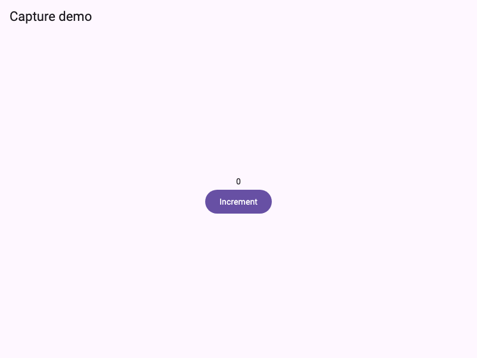
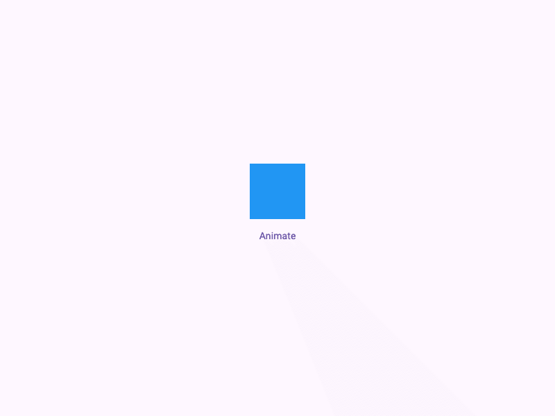

# widget_test_capture

[](https://pub.dev/packages/widget_test_capture)
[](LICENSE)

Capture screenshots, animations, and visual reports from Flutter widget tests.

`widget_test_capture` saves PNG screenshots, GIF animations, optional MP4
videos, golden results, and HTML reports. It is a development package. It does
not add generated screenshots to your `pubspec.yaml`.

## 📺 Capture previews

These files were generated by the example widget tests. The PNG shows a
captured Flutter screen, and the GIF shows a two-second animated panel.

<p align="center">
  
</p>

<p align="center">
  
</p>

Click the GIF preview to open the matching MP4 video:

[](doc/media/panel-animation-demo.mp4)

Regenerate the examples with `cd example && flutter test`, then create the MP4
with `cd example && dart run tool/encode_video.dart` (requires FFmpeg).

---

## 🚀 Features

- Capture the full Flutter view or one widget.
- Add named checkpoints to existing widget tests.
- Record deterministic animation frames using simulated test time.
- Export animation GIFs and storyboard GIFs.
- Export silent H.264 MP4 video with FFmpeg.
- Compare screenshots with approved golden images.
- Create an offline HTML gallery and JSONL manifests.
- Simulate device sizes, themes, locales, and text scaling.
- Save artifacts under `assets/widget_test/` by default.

---

## 📦 Install

```sh
flutter pub add --dev widget_test_capture
```

## 🧩 Dependencies

| Dependency | Used for |
| --- | --- |
| `flutter` and `flutter_test` | Widget rendering, test helpers, and Flutter image capture. |
| `image` | PNG cropping and pure-Dart GIF encoding. |
| `path` | Safe path handling across host operating systems. |
| `lints` and `test` (development only) | Code checks and package tests. |

This package was developed with AI assistance. AI helped implement the package
and choose its dependencies. The dependencies listed above are existing
third-party packages maintained by their respective authors; they were not
created by AI.

## 📸 Capture a widget

Use the helper in an existing `testWidgets` test:

```dart
import 'package:flutter/material.dart';
import 'package:flutter_test/flutter_test.dart';
import 'package:widget_test_capture/widget_test_capture.dart';

void main() {
  testWidgets('welcome screen', (tester) async {
    await tester.pumpWidget(const MaterialApp(
      home: Scaffold(
        body: Center(child: Text('Welcome', key: Key('welcome'))),
      ),
    ));
    await tester.pumpAndSettle();

    final capture = TestCapture(
      tester,
      const CaptureConfig(),
      'welcome screen',
    );
    await capture.png('full-view');
    await capture.png('welcome-text', finder: find.byKey(const Key('welcome')));
  });
}
```

Run it with:

```sh
flutter test
```

The full-view image uses the simulated Flutter view bounds. A Finder image uses
that widget's laid-out render bounds. The Finder must match exactly one widget.
Set `CaptureConfig(outputDirectory: 'build/visuals')` to choose another output
folder. Relative paths are resolved from the consumer project's root, even when
the test is nested in subfolders. Use `await capture.pngAuto()` for a numbered
checkpoint. File names support Unicode test names and are safe on macOS,
Windows, and Linux.

PNG files are numbered in capture order using the test case name. For example,
the first two captures in `Login flow` are `Login_flow_1.png` and
`Login_flow_2.png`. The checkpoint labels remain available in the JSON manifest
and HTML report. Each test run has a folder named with the test case and the
computer's local date and time in `YYYYMMDDHHmm` format, for example
`screenshots/counter_demo_202610130759/`.

## 🧪 Capture a wrapped test

The wrapper can capture the final state and make a best-effort failure image.
Capture remains opt-in; adding this package does not capture all tests.

```dart
import 'package:flutter/material.dart';
import 'package:flutter_test/flutter_test.dart';
import 'package:widget_test_capture/widget_test_capture.dart';

void main() {
captureTest(
  'counter interaction',
  config: const CaptureConfig(
    captureAtEnd: true,
    captureOnFailure: true,
  ),
  (tester, capture) async {
    await tester.pumpWidget(MaterialApp(
      home: Scaffold(
        body: Center(
          child: TextButton(
            key: const Key('increment'),
            onPressed: () {},
            child: const Text('Increment'),
          ),
        ),
      ),
    ));
    await tester.pumpAndSettle();

    await capture.png('initial');
    await capture.step('increment', () async {
      await tester.tap(find.byKey(const Key('increment')));
      await tester.pumpAndSettle();
    });
  },
);
}
```

Failure capture does not replace the original test error.

## 🧭 Record navigation in a video

Capture each route transition explicitly. Start recording immediately after
the tap so the controlled pumps include the transition animation. The example
below builds one ordered video from screen 1 through screen 3:

```dart
import 'dart:io';

final frames = <File>[];
frames.add(await capture.png('screen-1'));

await tester.tap(find.byKey(const Key('open-screen-2')));
frames.addAll(await capture.recordAnimation(
  'screen-1-to-2',
  duration: const Duration(milliseconds: 400),
  fps: 30,
));

await tester.tap(find.byKey(const Key('open-screen-3')));
frames.addAll(await capture.recordAnimation(
  'screen-2-to-3',
  duration: const Duration(milliseconds: 400),
  fps: 30,
));

await tester.runAsync(() => encodeMp4(
  frames,
  File('assets/widget_test/videos/navigation_flow_1.mp4'),
  fps: 30,
));
```

The app must expose the navigation buttons shown by the Finders. Each recorded
transition contributes its rendered frames in order. Use `capture.png` for a
static screen or `recordAnimation` around each interaction to include its
animation. MP4 encoding requires FFmpeg; if encoding fails, the PNG frames are
still saved.

## 🎞️ Animation and GIF

Record frames at controlled timestamps. The helper does not call
`pumpAndSettle()` between frames.

```dart
await tester.tap(find.byKey(const Key('animate')));
const fps = 15;
final frames = await capture.recordAnimation(
  'panel',
  duration: const Duration(seconds: 2),
  fps: fps,
);
await encodeAnimationGif(
  frames,
  File('assets/widget_test/gifs/panel_animation_1.gif'),
  fps: fps,
);
```

For a GIF made from named checkpoints, use `encodeStoryboard`. GIF timing is
stored in 10 ms units, so frame delays are rounded. GIF transparency is
flattened onto the chosen background. Frames use a shared canvas sized to the
largest frame.

GIF and MP4 exporters take an explicit output path. Follow the same test name
and sequence convention, such as `login_flow_1.gif` and
`login_flow_1.mp4`; use `_2`, `_3`, and so on for additional exports. The
example uses `panel_animation_1.gif` and `panel_animation_1.mp4`.

These are Flutter-rendered test frames. They do not record the desktop, device
OS, microphone, or arbitrary calls to `tester.pump()`.

## 🎥 MP4 video

Install FFmpeg with an H.264 encoder. For the example animation, run:

```sh
cd example
flutter test
dart run tool/encode_video.dart
```

This creates `example/assets/widget_test/videos/panel_animation_1.mp4`. MP4 encoding can
also be called directly:

```dart
await encodeMp4(
  frames,
  File('assets/widget_test/videos/panel_animation_1.mp4'),
  fps: 15,
  executable: '/path/to/ffmpeg', // optional; otherwise searched on PATH
);
```

FFmpeg is not installed or downloaded by this package. If encoding fails, the
PNG frames remain available.

## 🖼️ Golden comparison and device variants

Golden export and comparison are separate from screenshot capture. Comparison
uses Flutter's exact pixel comparator. Baselines update only when explicitly
requested with `GoldenMode.update` and `flutter test --update-goldens`.

```dart
await tester.pumpWidget(captureScenario(
  child: const RepaintBoundary(child: Text('Profile')),
  themeMode: ThemeMode.dark,
  locale: const Locale('en'),
  textScale: 1.2,
));
await tester.pumpAndSettle();
await expectCaptureMatchesGolden(tester, 'profile-dark');

const phone = CaptureDevice(
  name: 'phone',
  size: Size(360, 800),
  pixelRatio: 2,
);
await withCaptureDevice(tester, phone, () async {
  // Pump and capture the phone-sized view here.
});
```

View simulation does not reproduce a native device or platform implementation.
Host OS and Flutter version can change golden pixels.

## 🖼️ Images and assets

`precacheCaptureImage` prepares a local image. `MockNetworkImage` supplies
in-memory bytes without network access.

## 🛠️ Commands

```sh
dart run widget_test_capture:doctor
dart run widget_test_capture:report
dart run widget_test_capture:encode --format gif --output result.gif frame1.png frame2.png
dart run widget_test_capture:encode --format mp4 --output result.mp4 frame1.png frame2.png
dart run widget_test_capture:clean
dart run widget_test_capture:test --reporter expanded
```

`doctor` checks FFmpeg and H.264 support. `report` writes an offline HTML
gallery from manifests. `clean` removes files owned by this package and keeps
unrelated files. `test` forwards arguments to `flutter test` and preserves its
exit code. Add `--capture-report` to build a report after the tests.

Artifacts are grouped into `screenshots/`, `gifs/`, `videos/`, `goldens/`, and
`reports/` under the output directory. The default is
`assets/widget_test/`. Each test isolate writes its own manifest.

## 📱 Example app platforms

The example app includes Android, iOS, and web project files. Run the app on a
device or browser with `flutter run`. This shows the app UI; it does not create
test captures. Run `flutter test` to generate captures.

Widget-test capture currently targets host tests on macOS, Linux, and Windows.
Browser tests and integration tests are not supported for capture. The package
does not implement native Android or iOS screenshot plugins.

## ❤️ Author

Created by Thant Zin

GitHub Home: https://github.com/tz-thantzin  
Repository: https://github.com/tz-thantzin/widget_test_capture  
Copyright (©️) 2026 Thant Zin
